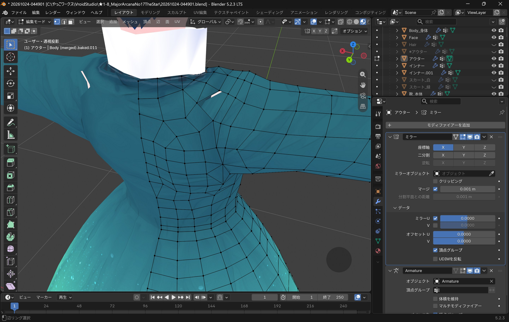
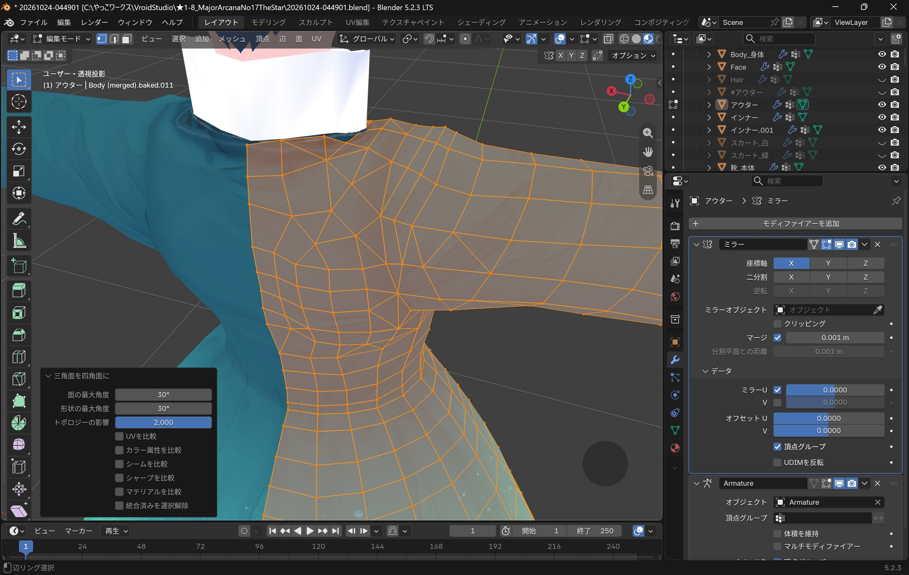

import { Steps } from "@astrojs/starlight/components";

## 三角面を四角面にしたら穴が開く問題

「Alt+J」で「三角面を四角面に」すると 
辺や面をループ選択できるようになって大変便利ですが 
たまに予期せぬ穴が開いてしまうことがあります 

 
これは「形状の最大角度」を低い値に設定することで回避できます

  

    
  

  

    
  

  {"Blenderよ,変なところにせくしーな穴を開けないで"}

他の設定値もいじってみましたが変化はなし…何が変わるのかはよくわからずじまい🤤
