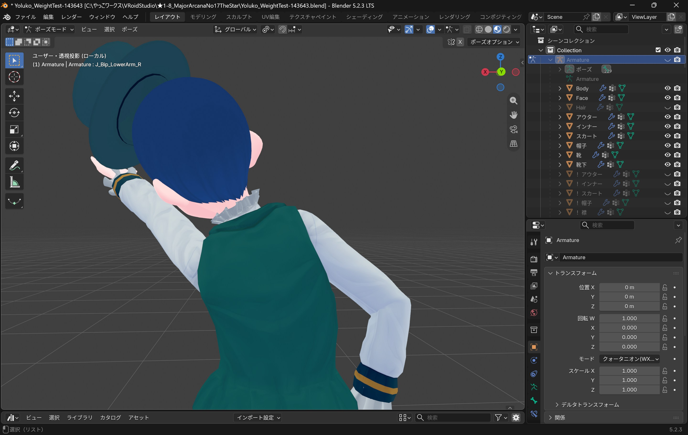

import { Steps } from "@astrojs/starlight/components";

## 三角面を四角面にしたら穴が開く問題


「Alt+J」で「三角面を四角面に」すると<br />
辺や面をループ選択できるようになって大変便利ですが<br />
たまに予期せぬ穴が開いてしまうことがあります<br />

<br />
これは「形状の最大角度」を低い値に設定することで回避できます

<div style={{ display: "flex", width: "100%", gap: "0.8rem" }}>
  <p style={{ flex: 1 }}>
    
  </p>
  <p style={{ flex: 1 }}>
    
  </p>
</div>
<p style={{ textAlign: "center", fontSize: "0.8rem" }}>
  {"Blenderよ,変なところにせくしーな穴を開けないで"}
</p>

他の設定値もいじってみましたが変化はなし…何が変わるのかはよくわからずじまい🤤

## ビューポート表示トグルのキー割り当て
アウトライナーの目玉アイコンをクリックしたときの動作を<br />
「Ctrl+H」に割り当ててみました<br />
<br />
<Steps>
1. プリファレンスのキーマップを開く
2. 「3Dビュー」 ＞ 「オブジェクトモード」 ＞ 「オブジェクトモード（グローバル）」と進む
3. 一番下の「新しく追加」を押し,以下の情報を入力

    
    ```markdown
    - 識別子： `wm.context_toggle`
    - アトリビュート： `object.hide_viewport`
    - 任意のキーボードショートカット（今回はCtrl+H）
    ```

4. 元々あるショートカットキーを削除するため以下の手順を行う
    ```markdown
    1. キーマップの「名前」で「コレクション」と入力
    2. 「コレクションを非表示」を探す
    3. 横にある「Ｘ」ボタンを押す
    ```
</Steps>

## ウエイトペイント

### 塗れない？！ なんで？！
ミラーモディファイアを適用している場合は<br />
ミラーされた側を塗っても何の反応もありません<br />
<br />
一旦モディファイアのビューポート表示を切って<br />
自分が塗ろうとしている面が実在するかどうかを確認しましょう

### ウエイトペイント：ベスト
これはベストのウエイトペイント画面ですが<br />
`J_Bip_C_Neck` が襟元・肩付近に影響していることが確認できます<br />
そして `J_Bip_C_UpperChest` にも同じ領域への影響がありますね
<div style={{ display: 'flex', width: '100%', gap: "0.8rem"  }}>
  <p style={{ flex: '1' }}>
    
  </p>
  <p style={{ flex: '1' }}>
    
  </p>
</div>
`J_Bip_C_Neck` のウエイトを以下のように塗りなおしてみます
<div style={{ display: 'flex', width: '100%', gap: "0.8rem" }}>
  <p style={{ flex: '1' }}>
    
  </p>
  <p style={{ flex: '1' }}>
    
  </p>
</div>
そしてポーズをとらせると…
<div style={{ display: 'flex', width: '100%', gap: "0.8rem" }}>
  <p style={{ flex: '1' }}>
    
  </p>
  <p style={{ flex: '1' }}>
    
  </p>
</div>
<p style={{ textAlign: 'center', fontSize: '0.8rem',margin:'0.6rem 0' }}>☄️「なんでやね～ん！ ……なんちゃって！ ……えへへ……」</p>
Neckのウエイトを減らすことでベストの襟元の変形が改善しました！