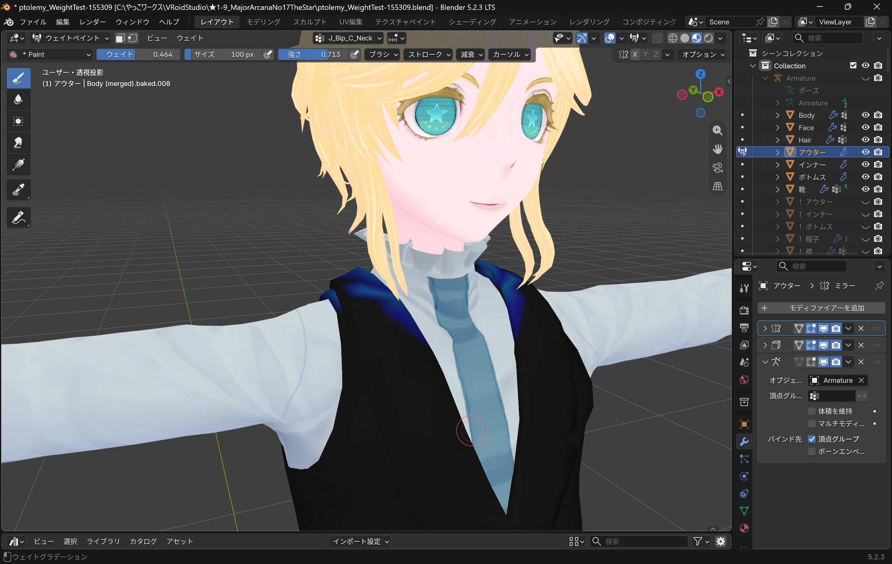
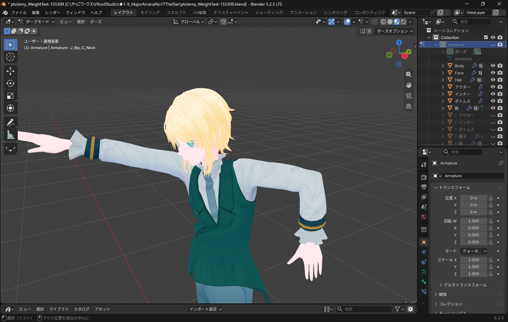
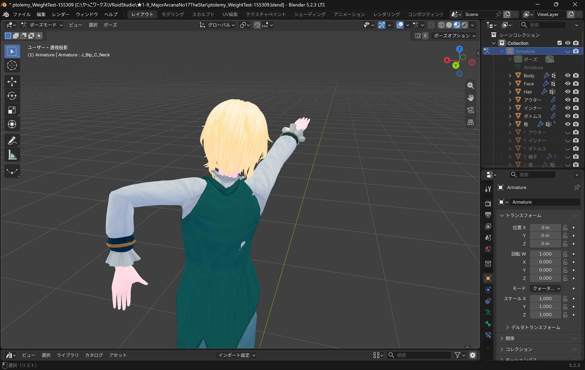
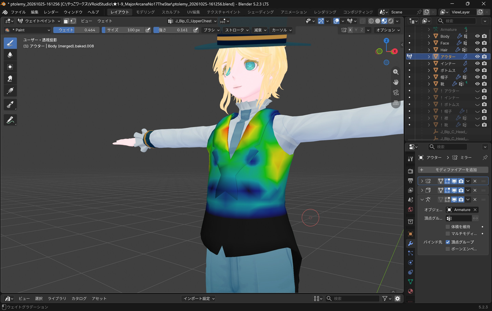
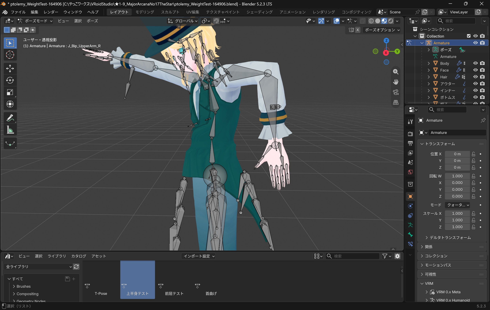

import { Steps } from "@astrojs/starlight/components";

## ウエイトペイント：ベスト
よるこさんのときと同じようにベストのウエイトペイントをしていきます 

	

		
	

	

		
	

若干,影響範囲を広めに考えるとうまくいきそうです

	

		
	

	

		
	

🔭「おや……水泳のポーズでしょうか？ フフ……」

腰のあたりになんか突き出ていますね？ 
 
もう少し正確に言うと,ベストの形がおなかの動きに沿っていないように見えます 
（白いのはブラウスのメッシュなので今は気にしません） 
 
そこで `J_Bip_C_UpperChest` のウエイトを少し塗りなおしました

	

		
	

	

		
	

使用前 ＞ 使用後（トレミィさんは被験サンプルではありません）

	

		
	

	

		
	

🔭「……そろそろ,元の姿勢に戻してはいただけませんか？」

かなり自然にみえるようになってきました！ 
実際にはここまで極端なポーズをとらせることはまずないので 
このあたりで一区切りつけておきます

## 衣装のアルファクリップ
はみ出す部分を透過させたテクスチャを作成する際は 
元のテクスチャにグリッドガイドを薄く重ねると視認性が上がり大変便利です

	

		
	

	

		
	

違う種類のテンプレートを重ね着している場合は特に覚えておきたいですネ
