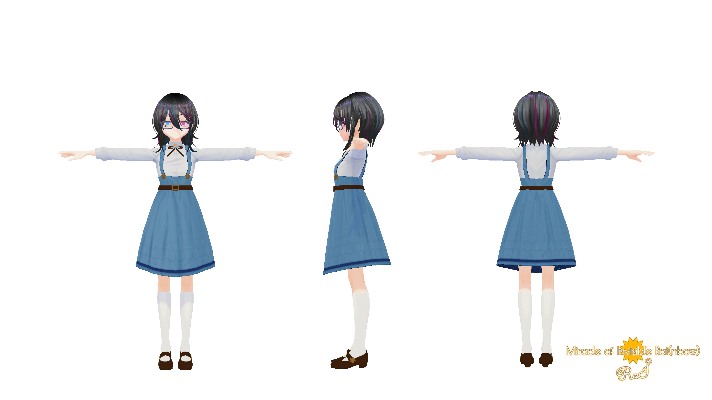
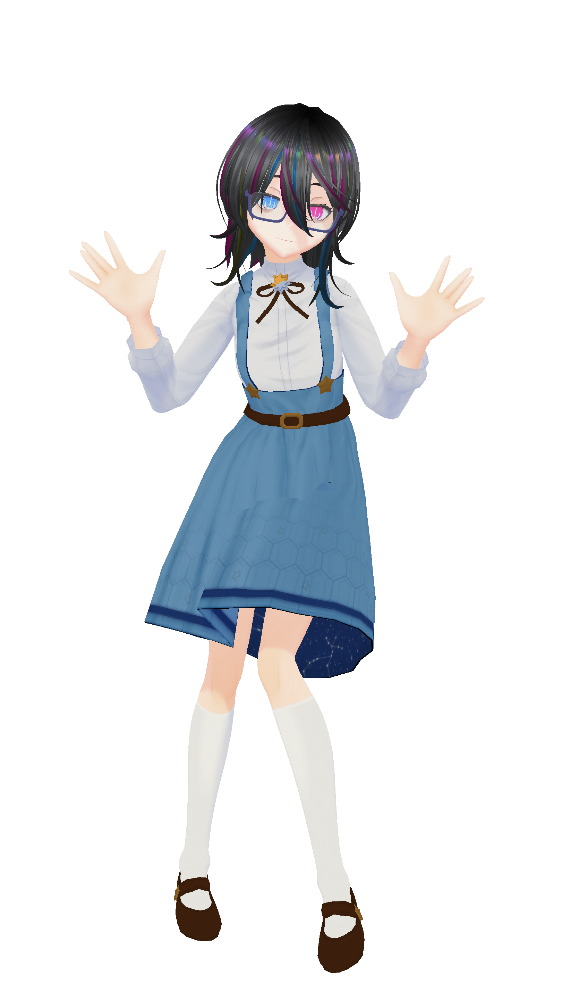
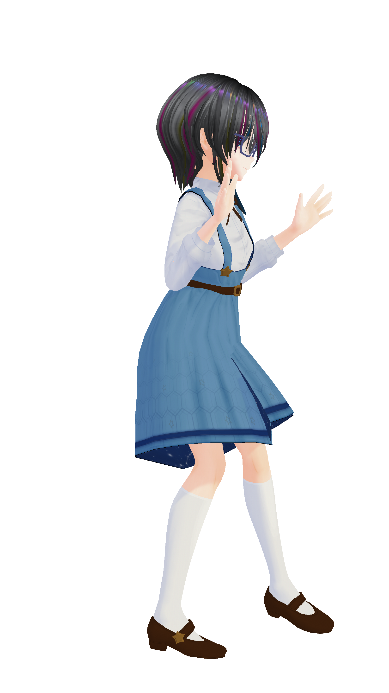

  

## レイちゃん折り紙事件

まずは最低限のウエイト転送を行い,エクスポートしてプリセットポーズをとらせてみました

  

    

      {" "}
    

    

      
    

  

  {/* <!-- prettier-ignore --> */}
  
{"※レイちゃんは折り紙ではありません"}

あまりにもひどい、レイちゃんが折り紙になってしまった…

### スカートが布っぽくならない問題

正確に言うとスカートが折り紙のように変な曲がり方をしています 

### 首元のアクセサリーの変形問題

「レイちゃん折り紙事件」の画像をよくみると、首元の鍵星も実は変です 
首の動きに追従して引き延ばされてしまっています 

## 寄り道：Spring Bonesの設定項目

  

  

